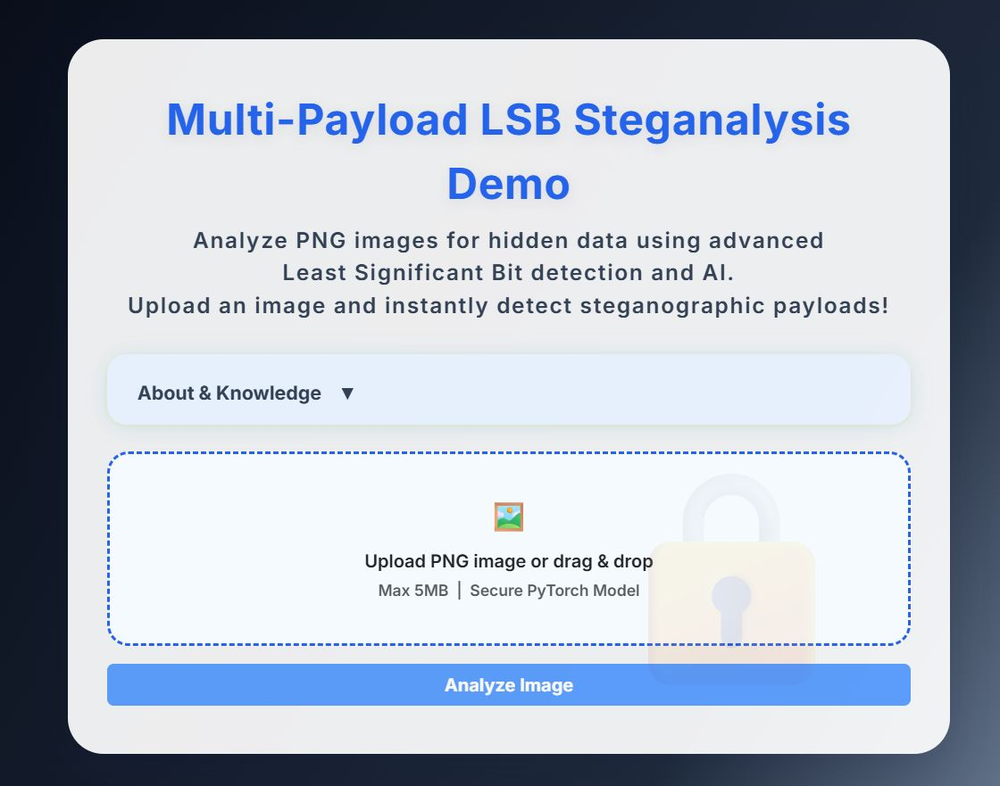

# LSB Steganography Detection

Multi-payload steganalysis for PNG images. The demo extracts least-significant-bit
statistics from an uploaded image and runs two PyTorch classifiers over them: a
binary clean/stego decision and a four-class payload estimate (`clean`, `html`,
`js`, `ps`). Everything runs locally on the server; the image never leaves the
machine.



## Status

The pipeline works end to end — upload, feature extraction, two models, JSON
response, UI. **The published weights are not a validated detector.** On a
28-image spot check the binary classifier labelled every clean photograph as
stego, and payload typing was mostly wrong. The method, results, and caveats
are in [`docs/evaluation.md`](docs/evaluation.md), and the harness that
produced them is [`eval/spot_check.py`](eval/spot_check.py).

There is no hosted demo. The Hugging Face Space previously linked from this
repository no longer exists, so the project runs locally.

## How it works

1. The upload is checked (PNG only, 5 MB, 40 megapixels) and decoded.
2. It is converted to RGB and resized to 256x256.
3. The low two bits of every channel are flattened into 196,608 values. Six
   summary statistics are appended: block entropy, transition rate, a
   chi-square statistic over the LSB histogram, and three character-distribution
   features derived from repacking LSB values into bytes.
4. The 196,614-value vector is standardised with `final_scaler.pkl`.
5. The binary network answers clean (🔓) or stego (🔒). If it answers stego, the
   second network estimates the payload type.
6. Both probability distributions are returned as JSON and drawn as bars.

## Quick start

### Requirements

- Python 3.10 or newer (scikit-learn 1.7.2 sets the floor)
- About 2 GB of free RAM while the models are resident (288 MiB each)
- ~600 MB of disk for the artifacts

### Install and run

```sh
git clone https://github.com/Gunjankumar55/LSB_steganography_detection.git
cd LSB_steganography_detection

python -m venv .venv
source .venv/bin/activate        # Windows: .venv\Scripts\activate

# CPU-only PyTorch keeps the download to ~200 MB instead of ~2.5 GB
pip install --index-url https://download.pytorch.org/whl/cpu torch==2.8.0
pip install -r requirements.txt

python scripts/fetch_models.py
python app.py
```

Open <http://127.0.0.1:5000>.

`python scripts/fetch_models.py` downloads the five artifacts from the
`v1.0.0` release, verifies each against a pinned SHA-256 digest, and skips
files that already match. The weights are not in the repository or in Git LFS.

### Run the tests

```sh
pip install -r requirements-dev.txt
python -m pytest
```

Model-dependent tests skip automatically when the artifacts have not been
downloaded.

### Configuration

`python app.py` binds to `127.0.0.1:5000` with debugging off. Override with:

| Variable | Default | Purpose |
| --- | --- | --- |
| `HOST` | `127.0.0.1` | Interface to bind |
| `PORT` | `5000` | Port to listen on |
| `FLASK_DEBUG` | unset | Set to `1` to enable the Flask debugger |

The Flask development server is not a production server. Put a WSGI server
and a reverse proxy in front of it, and keep the debugger off, before exposing
it to a network.

## API

`POST /predict`, multipart form, one field named `file`:

```json
{
  "binary_prediction": {
    "class": "clean",
    "confidence": 0.9994426369667053,
    "probabilities": { "clean": 0.9994426369667053, "stego": 0.0005573421949520707 }
  },
  "multiclass_prediction": {
    "payload_type": "clean",
    "probabilities": { "clean": 1.0, "html": 0.0, "js": 0.0, "ps": 0.0 }
  }
}
```

Errors return `{"error": "..."}` with a matching status:

| Status | Cause |
| --- | --- |
| 400 | Missing field, empty file, not a PNG, smaller than 8 px, larger than 40 MP |
| 413 | Body larger than 5 MB |
| 503 | Model artifacts are not installed |
| 500 | Unexpected failure; details are logged, not returned |

## Project layout

```text
app.py                    Flask app, upload validation, error handling
steganalysis/
  features.py             LSB and statistical feature extraction
  models.py               The shared DNN definition
  inference.py            Artifact loading, scaling, prediction
templates/index.html      Upload UI and probability bars
scripts/fetch_models.py   Download and verify the release artifacts
eval/spot_check.py        Reproducible spot check behind docs/evaluation.md
tests/                    Feature, inference, and HTTP contract tests
docs/evaluation.md        Method, results, and caveats
models/                   Downloaded artifacts (git-ignored)
```

## Model

| Property | Value |
| --- | --- |
| Input | 196,614 floats |
| Hidden layers | 384 → 192 → 96, batch norm, ReLU, dropout (0.45 / 0.35 / 0.25) |
| Outputs | 2 (clean, stego) and 4 (clean, html, js, ps) |
| Parameters | 75,594,146 and 75,594,340 |
| Cold load | ~0.85 s for both checkpoints on CPU |
| Inference | ~0.1 s per image on CPU |

The two models are separate checkpoints but share the same architecture and an
identical first layer, which is why each file is 288 MiB.

Training code, training data, and held-out metrics are **not** in this
repository. The weights are published as-is; the only measurement available is
the spot check in [`docs/evaluation.md`](docs/evaluation.md).

The `.pkl` artifacts are Python pickles and the checkpoints are loaded with
`torch.load`. Only load artifacts you trust; the fetch script pins SHA-256
digests for the published ones.

## Limitations

- The binary classifier is heavily biased toward "stego" on out-of-distribution
  images, and payload typing is unreliable. See the evaluation notes.
- The demo handles one image per request with no queue; both networks are held
  in memory for the life of the process.
- PNG only, 5 MB, 40 megapixels. JPEG uploads are rejected even though JPEGs
  could be decoded.
- No authentication, rate limiting, or upload retention policy. Do not expose
  it publicly as-is.
- The Flask development server is the only entry point provided.

## License

MIT License, Copyright (c) 2025–2026 Gunjankumar Choudhari. See
[`LICENSE`](LICENSE).

## Author

**Gunjankumar Choudhari**

- GitHub: <https://github.com/Gunjankumar55>
- Portfolio: <https://gunjankumar55.github.io/Gunjan_Portfolio/>
